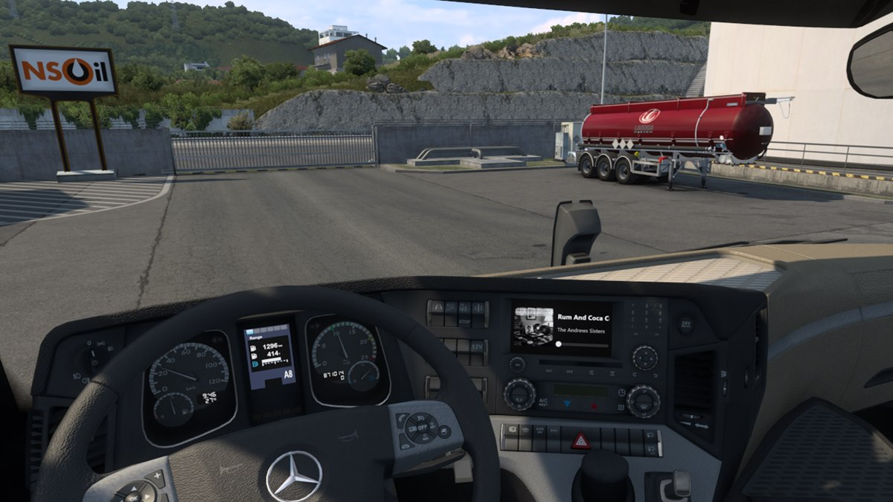

# ets-spotify

Spotify on the built-in navigation screen of your truck in **Euro Truck Simulator 2**: cover art, title, artist and progress, right on the dashboard. Keyboard controls, auto-pause and speed-dependent volume, like a real truck radio.



The music plays in the regular Spotify app on your PC or phone. The mod shows what is playing and controls playback through the Spotify Web API, so everything stays in sync with your phone: skip a track there and the cab screen updates within a second.

## Features

- **Player on the built-in screen.** The plugin finds the navigation display texture by itself and replaces it with its own picture. No models or `.scs` mods needed. Long titles scroll back and forth instead of being cut.
- **Hotkeys:** play/pause, next and previous track. Keys can be changed in the ini file.
- **Auto-pause.** Music pauses in the game menu and when the ignition is off, and resumes when you drive again.
- **Speed-dependent volume.** Quieter when standing, louder on the highway. Works through the Windows volume mixer, instantly.
- **Any truck.** The picture can be fitted to each truck's screen in game; the settings are saved per truck.
- **Safe login.** OAuth PKCE in the browser; the token is stored encrypted (DPAPI); the mod never sees your password.
- **Interface languages:** English and Russian.

## Requirements

- Windows 10/11 x64.
- Euro Truck Simulator 2 1.62 with the DirectX 11 renderer (the default).
- Spotify **Premium**: without it Spotify does not allow controlling playback through the API.
- The Spotify app on your PC (needed for speed-dependent volume) or on your phone.

## Installation

1. Download `ets_spotify.dll` from the releases page (or build it yourself, see below).
2. Put it into `<game folder>\bin\win_x64\plugins\` (create the `plugins` folder if it does not exist).
3. Start the game. It warns that SDK plugins are loaded — confirm.

To uninstall, delete `ets_spotify.dll` from the `plugins` folder.

## Spotify setup (once)

Since 2026 Spotify does not let one developer app be shared by more than five users, so every player creates their own. It takes about five minutes.

1. Open [developer.spotify.com/dashboard](https://developer.spotify.com/dashboard) and log in with your Spotify account.
2. **Create app**: any name; add `http://127.0.0.1:8888/callback` to **Redirect URIs**; tick **Web API**; save.
3. Copy the app's **Client ID** (the client secret is not needed).
4. Put it into `Documents\Euro Truck Simulator 2\ets_spotify.ini` (the file appears after the first start of the game with the mod):
   ```ini
   [spotify]
   client_id=<your Client ID>
   ```
5. In game, get into the truck and press **F8**: the browser opens the Spotify login. Log in and return to the game. You will not need to log in again.

If Spotify says the user is not registered, add your email under **User Management** of the app. If port 8888 is busy, change `port` in the ini and the Redirect URI of the app to the same number.

## Keys

| Key | Action |
|---|---|
| F8 | player on the navigation screen: on / off |
| F8, hold for 1 s | fit the picture to this truck's screen |
| F9 | play / pause |
| `.` / `,` | next / previous track |

F9, `.` and `,` only work while driving, not in menus. Keys can be changed in the `[keys]` section (see "Settings").

## Other trucks

The mod looks for the display the game draws the map on, so it works in any truck with a built-in navigation screen. How much of the picture is visible depends on the screen model. If the picture is cut off, has margins or looks stretched, fit it:

1. Hold **F8** for about a second. Instead of the player you see a frame: pink outside, yellow lines on the edges, two circles inside. The edge being adjusted is green and thick.
2. **F9** picks what to adjust: left → right → top → bottom edge → proportions → display.
3. **`,` / `.`** move the edge (left and up / right and down); they can be held down. For "proportions" they make the picture narrower or wider: some screens stretch it, and the circles then look like ovals. For "display" they switch between the cab's displays (the ones showing the map come first), if the player landed on the wrong one.
4. The frame fits when no pink is visible, all four lines are still visible and the circles are round. **F8** saves and leaves.

The settings go into the `[nav.<truck id>]` section and are picked up automatically whenever you get into that truck. To try other trucks without buying them, take **quick jobs**: each job card shows which truck you get.

**Trucks without a navigation screen** (older models) usually still have a display in the instrument cluster, behind the steering wheel. Put the player there: hold **F8**, press **F9** until "display", press **`.`**, fit the edges and save with **F8**. A display picked this way is pinned for that truck and keeps the player even though it never shows the map.

## Settings

Everything lives in `Documents\Euro Truck Simulator 2\ets_spotify.ini`. The plugin adds missing keys with their default values.

| Section and key | Default | What it does |
|---|---|---|
| `[spotify] client_id` | — | Client ID of your Spotify app |
| `[spotify] port` | `8888` | port of the local login listener (Redirect URI) |
| `[keys] screen` | `F8` | player on/off; hold to fit the picture |
| `[keys] play_pause` | `F9` | play / pause |
| `[keys] next`, `previous` | `PERIOD`, `COMMA` | next / previous track |
| `[autopause] game_pause` | `1` | pause while the game is paused |
| `[autopause] ignition_off` | `1` | pause while the ignition is off |
| `[volume] speed_volume` | `1` | speed-dependent volume |
| `[volume] standstill` | `0.700` | share of the volume when standing |
| `[volume] full_kmh` | `90.000` | speed at which the volume is full |
| `[ui] language` | `auto` | screen language: `auto` (from Windows), `en`, `ru` |
| `[nav] u0 u1 v0 v1` | Iveco | visible window of the picture for trucks without their own settings |
| `[nav] aspect` | `1.000` | how much the screen stretches the picture horizontally |
| `[nav.<id>]` | — | window, proportions and display of one truck (written by the fitting mode); `display_pinned=1` means the display was picked by hand and is used even without the map |
| `[debug] tools` | `0` | diagnostic keys used to find the screen (see [docs/architecture.md](docs/architecture.md)) |

Key names: `F1`…`F24`, letters and digits, `NUMPAD0`…`NUMPAD9`, `PERIOD`, `COMMA`, `MINUS`, `PLUS`, `SEMICOLON`, `SLASH`, `BACKQUOTE`, `LBRACKET`, `RBRACKET`, `BACKSLASH`, `QUOTE`, `INSERT`, `DELETE`, `HOME`, `END`, `PAGEUP`, `PAGEDOWN`, arrows `UP`/`DOWN`/`LEFT`/`RIGHT`. New keys apply after restarting the game; everything else applies on the fly.

## Troubleshooting

- Log: `Documents\Euro Truck Simulator 2\ets_spotify.log`. Every module has its own prefix: `[nav]` screen, `[spotify]` login and player, `[cabin]` auto-pause and volume, `[truck]` the current truck.
- No player on the screen: make sure the game runs on DirectX 11 and the truck has a screen with the map. The `[nav] displays in this truck` log line shows which displays were found.
- If the game crashes, Spotify's volume in the Windows mixer may stay lowered: restore it there by hand.
- **TruckersMP**: compatibility has not been tested; use the mod in single player.

## Building from source

Requires Visual Studio 2022 with the "Desktop development with C++" workload; it includes CMake. No other dependencies.

```powershell
cmake --workflow --preset default          # build and run the tests (no game needed)
cmake --install build --config Release     # copy the DLL into the game; close the game first
```

`cmake --install` finds the game through Steam. If it is installed elsewhere, add `--prefix <game folder>`.

How it works and how to extend it: [docs/architecture.md](docs/architecture.md). The original research: [docs/research.md](docs/research.md).

## License

[MIT](LICENSE): use, change and include the code in your own projects freely, keeping the copyright notice.

## Disclaimer

Unofficial mod. Not affiliated with SCS Software or Spotify. Euro Truck Simulator 2 is a trademark of SCS Software; Spotify is a trademark of Spotify AB.
